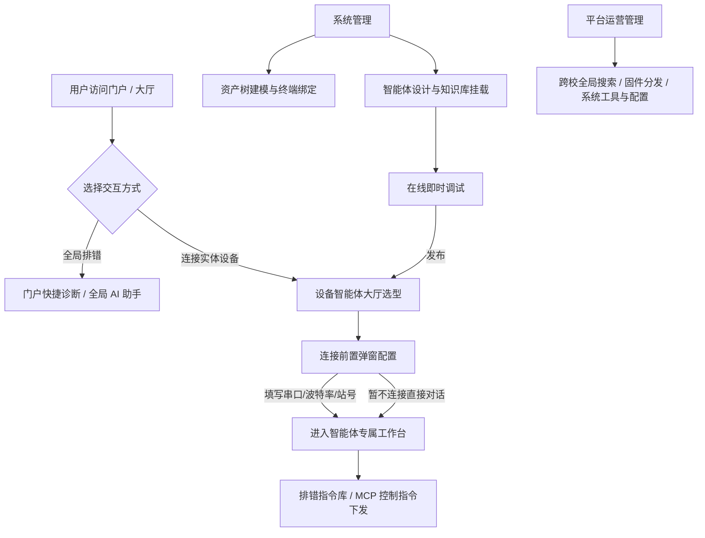

# 【V1.0.0】UUSIMA 硬件智能体系统 用户需求规格说明书

| 文档属性 | 详细信息 |
| :--- | :--- |
| **文档名称** | 【V1.0.0】UUSIMA 硬件智能体系统 用户需求规格说明书 |
| **系统名称** | 硬件智能体系统（by UUSIMA） |
| **原型地址** | `/`、`/agents`、`/agents/:id`、`/console` |
| **文档版本** | V1.0.0（基线版） |
| **编写人** | 产品与架构团队 |
| **生效日期** | 2026-11-17 |

---

## 目录

- [1. 需求背景与产品定位](#1-需求背景与产品定位)
- [2. 名词定义与缩略语](#2-名词定义与缩略语)
- [3. 业务流程与系统架构](#3-业务流程与系统架构)
- [4. 平台整体界面布局与设计规范](#4-平台整体界面布局与设计规范)
- [5. 功能需求说明](#5-功能需求说明)
  - [5.1 门户中心](#51-门户中心)
  - [5.2 设备智能体大厅](#52-设备智能体大厅)
  - [5.3 智能体专属工作台](#53-智能体专属工作台)
  - [5.4 系统管理](#54-系统管理)
  - [5.5 平台运营管理](#55-平台运营管理)
- [6. 非功能需求](#6-非功能需求)
- [7. 测试关注点与验收基线](#7-测试关注点与验收基线)
- [8. 其他注意事项](#8-其他注意事项)

---

## 1. 需求背景与产品定位

### 1.1 需求背景
在新工科教学实训、物联网工程与工业互联网实验场景中，硬件设备种类繁多（边缘网关、PLC、工业相机、ZigBee 传感节点、机械臂等），通信协议异构（Modbus、RS485、TCP/MQTT、RTSP），师生与工程师在设备连接、寄存器解析、算法报错排查及固件升级过程中存在操作门槛高、排障链路长、运维分散等痛点。

### 1.2 产品定位
**UUSIMA 硬件智能体系统**是一套面向新工科实训与工业物联网场景的 AI 硬件大模型与设备协同平台。系统将大模型对话能力、私有知识库与 MCP 硬件控制协议深度结合，实现自然语言故障诊断、设备实时连接、控制指令下发与资产终端集中运维的业务闭环。

### 1.3 用户角色

| 角色名称 | 核心职责 | 权限范围 |
| :--- | :--- | :--- |
| **普通用户** | 门户检索排错、浏览设备大厅、连接终端并执行对话调试 | 访问 `/`、`/agents`、`/agents/:id` 及全局 AI 助手 |
| **系统管理员** | 管理本机构资产树、终端设备及自定义智能体开发与发布 | 访问 `/console?scope=system`，操作当前租户数据 |
| **平台运营管理员** | 跨租户全局终端与智能体监管、固件分发、系统工具与底座配置 | 访问 `/console?scope=platform`，操作全平台全局数据 |

---

## 2. 名词定义与缩略语

| 名词 / 术语 | 英文 / 缩写 | 定义与技术说明 |
| :--- | :--- | :--- |
| **硬件智能体** | Hardware Agent | 绑定特定硬件型号、通信协议、排错知识库及 MCP 工具集的专业 AI 助手 |
| **模型上下文协议** | MCP | 标准化 AI 模型与外部硬件设备/脚本工具交互的协议接口，支持 JSON Schema 参数校验 |
| **串口 / 波特率** | Serial / Baud Rate | 硬件串行通信接口（如 `COM1`、`/dev/ttyUSB0`）及传输速率（`9600` ~ `115200` bps） |
| **Modbus 协议** | Modbus RTU / TCP | 工业现场总线通信协议，支持 `0x03` 读保持寄存器、从站地址（`1~247`）及 CRC 校验 |
| **实时流传输协议** | RTSP | 人工智能前端摄像头视频流采集协议（默认端口 `554`） |
| **资产层级树** | Asset Tree | 按“实训基地 -> 教学楼 -> 实训室/车间/大棚”组织的多级物理空间拓扑 |
| **设备序列号** | SN | 硬件终端出厂唯一物理标识（如 `NL-2026-SN88901`） |

---

## 3. 业务流程与系统架构

### 3.1 业务全景流转链路

### 3.2 核心领域实体
- **租户（TenantItem）**：隔离不同院校与实训机构的业务空间（如“新大陆教育行业云”、“新大陆工程技术学院”、“华东理工实训示范校”等）。
- **多级资产（AssetItem）**：支持无限级父子嵌套的物理空间节点，关联 `parentId`、`orderNum` 与 `schoolName`。
- **硬件终端（TerminalItem）**：归属于特定租户与资产节点，包含 `ip`、`sn`、`model`、`status`（`online` / `offline`）、`loginAccount` 及 `lastOnlineTime`。
- **设备智能体（HardwareAgentItem / CustomAgent）**：分为系统发布（`system`）与用户自定义（`custom`），核心关联连接字段（`connectionFields`）、MCP 工具集（`mcpConfig`）、快捷指令树（`commandTree`）与知识库（`AgentKnowledgeBase`）。
- **终端运行日志（TerminalLogItem）**：记录终端 `开机`、`关机`、`异常`、`告警`、`调试`、`升级`、`故障` 7 类事件及底层协议报文详情。
- **固件包（FirmwareItem）**：包含版本号、适配硬件型号、文件名、文件大小、SHA-256 校验值及发布状态（`发布` / `未发布` / `下架`）。

---

## 4. 平台整体界面布局与设计规范

### 4.1 全局顶部导航栏
固定于页面顶部（高度 `64px`，`z-50`），所有主路由页面共享：
- **左侧品牌区**：展示四象限品牌徽标及“硬件智能体 系统 by UUSIMA”标识，点击跳转回首页（`/`）。
- **居中主导航**：包含 `首页`（`/`）、`设备智能体大厅`（`/agents`，兼容 `/hardware-agent` 重定向）、`控制台`（`/console`，兼容 `/ai-lab` 重定向）。
- **右侧租户与用户菜单**：
  - **租户切换器**：展示当前激活租户名称，点击弹出租户列表，切换后持久化至 `localStorage`。
  - **个人中心下拉卡片**：展示用户姓名、手机号、角色、跳转入口（“控制台 · 系统视角” `/console?scope=system`、“控制台 · 平台视角” `/console?scope=platform`）、账号信息编辑弹窗及退出登录提示。

### 4.2 全局 AI 助手
在非 `/agents/:id` 路由页面常驻右下角，支持三种工作模式：
- **通用模式（`general`）**：支持自然语言硬件故障排查，自动检索平台默认知识库并返回引用来源（`kbCitations`）、诊断步骤（`steps`）及一键 MCP 修复按钮（`mcpAction`）。
- **MCP 工具生成模式（`mcp_config`）**：在智能体设计器中唤起，结合协议类型自动生成标准 MCP 工具定义，支持【追加】或【替换】写入当前智能体配置。
- **智能体创建模式（`agent_create`）**：通过自然语言描述生成包含名称、硬件型号、协议与 MCP 工具的智能体草稿并支持一键创建。
- **视窗形态**：支持右下角悬浮窗与居中沉浸大窗切换，支持清空会话记录。

---

## 5. 功能需求说明

### 5.1 门户中心

#### 5.1.1 搜索与快捷诊断
1. **主输入框**：居中圆角大输入框，占位提示为“询问硬件排错方案、配置参数或直接唤醒设备智能体...”，支持一键清空及回车/点击 `发送` 提交，提交后以居中沉浸模式唤起全局 AI 助手。
2. **预设快捷诊断标签**：
   - `USR-410s 串口丢包自愈`：触发串口波特率不匹配排查步骤与参数同步 MCP 动作。
   - `ECU-1251 Modbus 协议解析`：触发 RS485 总线阻抗与终端匹配电阻诊断。
   - `视觉分拣台机械臂零位校准`：触发九点标定矩阵与编码器脉冲偏移自标定。
   - `大棚传感器数据断流修复`：触发 ZigBee 节点低功耗供电探测与拓扑自愈。

#### 5.1.2 热门设备智能体
1. **展示字段**：行业彩色胶囊徽标（物联网、工业互联网、人工智能、智慧农业）、设备实拍图、智能体名称、短标题/型号、简介、通信端口标识及 `立即体验` 按钮。
2. **交互规则**：默认展示 4 张高热度智能体卡片，右上角提供 `全部设备 (48+)` 跳转至 `/agents`；点击卡片或 `立即体验` 触发连接前置弹窗。

---

### 5.2 设备智能体大厅

#### 5.2.1 筛选与搜索
1. **筛选项定义表**：

| 筛选条件 | 控件类型 | 选项值 / 输入规则 | 默认值 | 校验与限制 |
| :--- | :--- | :--- | :--- | :--- |
| **发布来源** | 分段选择器 | `全部`、`系统发布`、`用户发布`（带实时数量统计） | `全部` | 切换后重置页码至第 1 页 |
| **行业分类** | 胶囊标签组 | `全部`、`物联网`、`工业互联网`、`人工智能`、`智慧农业` | `全部` | 单选，切换后重置页码 |
| **关键词搜索** | 文本输入框 | 模糊匹配名称、描述、硬件型号、作者 | 空字符串 | 不区分大小写，实时过滤 |

2. **条件逻辑与重置**：三个筛选维度之间为逻辑 `AND` 关系；仅展示 `status === 'published'` 的已发布智能体；任意筛选条件变更时自动将当前页码重置为第 1 页。

#### 5.2.2 列表与视图
1. **列表展示字段**：

| 字段名称 | 展示形式 | 说明 |
| :--- | :--- | :--- |
| **行业标签** | 左上角彩色徽标 | 区分物联网、工业互联网、人工智能、智慧农业 |
| **设备图片** | 16:9 居中展示图 | 展示对应硬件设备外观图 |
| **智能体名称** | 加粗主标题 | 最多展示 1~2 行，超出省略 |
| **型号与端口** | 等宽字体副文本 | 展示设备型号与通信端口 |
| **来源与热度** | 底部元信息 | 区分系统发布/用户作者、浏览量 |
| **操作按钮** | 主按钮 | `立即体验`，点击触发连接前置弹窗 |

2. **分页与空态**：每页固定展示 `8` 条，底部提供上一页、页码跳转与下一页控制；无匹配数据时展示空态引导提示。

#### 5.2.3 连接前置弹窗
点击启动任意智能体时弹出，用于在进入工作台前完成硬件链路参数初始化：
- **默认串口连接字段**（未自定义连接字段时启用）：
  - `串口设备`：下拉选择，选项包含空（自动探测）、`COM1`、`COM2`、`COM3`、`COM4`、`/dev/ttyUSB0`、`/dev/ttyUSB1`。
  - `波特率`：下拉选择，选项 `9600`、`19200`、`38400`、`57600`、`115200`，默认 `9600`。
  - `设备MODBUS地址`：数字输入框，默认 `1`。
- **操作分支**：
  - `开始对话`：校验必填项后拼接连接摘要（密码类型脱敏为 `******`），携带连接参数跳转至 `/agents/:id`。
  - `暂不连接，直接进入对话`：跳过参数绑定直接跳转至 `/agents/:id`。
  - `取消` / 关闭按钮：关闭弹窗，留在本页。

---

### 5.3 智能体专属工作台

#### 5.3.1 会话与连接状态
- **左侧会话栏**：支持折叠/展开，点击 `新建对话` 创建新会话；历史会话按 `今天`、`7天内`、`更早之前` 自动分组，支持切换与删除。
- **顶部连接状态栏**：展示当前智能体名称、硬件型号、端口及连接状态徽标（已连接显示参数摘要；未连接点击可重新唤起连接前置弹窗）。

#### 5.3.2 欢迎卡片与双指令库
1. **引导式提问卡**：展示需用户提供的排查要素清单（`guideBullets`）及知识库期望输出提示（`guideTip` + `guideHighlight`）。
2. **排错自检指令库**：展示预设排错快捷按钮，点击后自动填充提问并输出诊断回复，附带可执行代码片段提示（`codeHint`）及一键复制功能。
3. **MCP 控制指令库**：展示预设设备反向控制指令，点击后模拟通过 MCP 协议下发指令并返回执行回执。
4. **消息交互**：每条 AI 回复支持语音播报开关、点赞/点踩反馈、一键复制及多模态附件（图片/文档/语音）输入。

---

### 5.4 系统管理

系统管理面向当前租户（本校/本机构），包含 **终端管理**、**资产管理**、**自定义智能体管理** 与 **运行概览** 4 个核心模块，支持本地机构内的设备运维与智能体全生命周期开发。

#### 5.4.1 终端管理
1. **筛选项定义表**：

| 筛选条件 | 控件类型 | 选项值 / 输入规则 | 默认值 | 校验与限制 |
| :--- | :--- | :--- | :--- | :--- |
| **登录账号** | 文本输入框 | 模糊匹配终端当前登录账号（`loginAccount`） | 空字符串 | 支持一键清空（`✕`） |
| **综合关键词** | 文本输入框 | 模糊匹配终端名称、设备型号、IP 地址、序列号、关联资产 | 空字符串 | 不区分大小写，支持一键清空 |
| **关联资产** | 多选下拉面板 | 勾选多个资产名称（带资产下设备数量徽标），面板内支持关键词二次过滤 | 未勾选（全部） | 已选资产以标签条形式外显，支持单个移除或一键清空 |
| **在线状态** | 分段选择器 | `全部`、`仅在线`、`仅离线` | `全部` | 单选切换 |

2. **条件逻辑与重置**：上述 4 项筛选条件之间为逻辑 `AND` 关系；右上角实时展示当前筛选结果总数，并支持点击 `刷新` 按钮更新在线心跳状态与统计计数（在线数 / 离线数）。

3. **列表展示字段**：

| 字段名称 | 展示形式 | 说明 |
| :--- | :--- | :--- |
| **复选框** | 多选框 | 支持单行勾选及表头本页全选 |
| **名称** | 图标 + 加粗文本 | 终端设备名称 |
| **设备型号** | 等宽字体文本 | 硬件型号编码，空值显示 `—` |
| **IP 地址** | 等宽字体文本 | 终端局域网 IP |
| **当前状态** | 彩色状态胶囊 | `在线`（绿色脉冲圆点）/ `离线`（灰色圆点） |
| **关联资产** | 资产标签 | 绑定的实训室/车间节点名称 |
| **最近上线时间** | 等宽时间文本 | 格式为 `YYYY-MM-DD HH:mm:ss` |
| **登录账号** | 文本 | 当前使用该终端的实训账号 |
| **设备序列号** | 等宽字体文本 | 唯一设备 SN 编码 |
| **操作** | 按钮 + 更多下拉 | 主按钮为 `详情`；点击 `更多` 展开 `关联资产`、`固件升级`、`日志` |

4. **批量操作与日志穿透**：
   - **批量操作工具条**：勾选 1 台及以上终端时顶部浮现，支持 `批量解除资产关联`、`批量升级固件`（弹窗选择目标固件下发）、`批量删除设备`（需二次确认）及 `清空选择`。
   - **终端运行日志抽屉**：展示 `开机`、`关机`、`异常`、`告警`、`调试`、`升级`、`故障` 7 类事件，支持按类型过滤并查看 `protocol`、`errorCode`、`rawPacket`（原始报文）、`registers`（寄存器状态）及 `actionTaken`。

#### 5.4.2 资产管理
1. **全局控制与筛选项定义表**：
   - **全局控制**：顶部提供 `展开全部`（递归展开所有父子层级）、`折叠全部`（收起全部节点）及 `新增资产` 按钮。

| 筛选条件 | 控件类型 | 选项值 / 输入规则 | 默认值 | 校验与限制 |
| :--- | :--- | :--- | :--- | :--- |
| **资产名称** | 文本输入框 | 模糊匹配实训基地、教学楼、实训室等节点名称 | 空字符串 | 支持一键清空，右侧实时统计资产节点总数 |

2. **树形列表展示字段**：

| 字段名称 | 展示形式 | 说明 |
| :--- | :--- | :--- |
| **资产名称** | 缩进树形节点 + 展开箭头 | 按层级缩进展示，父节点显示展开/收起图标 |
| **上级** | 文本 | 所属父级资产名称，顶级节点显示 `—` |
| **排序号** | 数字 | 同级节点展示顺序号（`orderNum`） |
| **备注** | 文本 | 空间用途与设备配置说明 |
| **操作** | 文本按钮组 | 支持 `编辑`、`新增下级`、`删除` |

3. **增删改与防误删规则**：新增/编辑弹窗包含 `资产名称`（必填）、`上级资产`（下拉树选择）、`排序号`（数字）及 `备注`；删除节点时若存在子级资产或已关联终端，系统拦截物理删除并给出保护提示。

#### 5.4.3 自定义智能体管理
1. **新增方式与筛选项定义表**：
   - **新增智能体下拉菜单**：提供两种创建入口——`手动创建`（填写名称、硬件型号后创建）与 `AI 创建`（唤起全局 AI 助手自然语言生成草稿）。

| 筛选条件 | 控件类型 | 选项值 / 输入规则 | 默认值 | 校验与限制 |
| :--- | :--- | :--- | :--- | :--- |
| **关键词搜索** | 文本输入框 | 模糊匹配智能体名称、描述 | 空字符串 | 变更时重置页码至第 1 页 |
| **发布状态** | 分段选择器 | `全部`、`已发布`、`未发布` | `全部` | 单选切换，变更时重置页码 |

2. **双模视图切换与展示字段**：
   - **方块宫格视图（图文）**：每行展示 4 张卡片，突出封面图预览、右上角发布状态角标、名称、两行简介、使用人数、知识库及文档统计。
   - **紧凑列表视图（列表）**：单行横向排布，左侧展示缩略封面、名称、状态徽标、描述及知识库统计，右侧固定对齐操作按钮组。

| 字段名称 | 展示形式 | 说明 |
| :--- | :--- | :--- |
| **封面图** | 缩略图 / 横幅图 | 智能体外观或场景配图 |
| **智能体名称** | 加粗标题 | 智能体显示名称 |
| **发布状态** | 彩色状态胶囊 | `已发布`（绿色）/ `未发布`（灰色） |
| **简介描述** | 多行截断文本 | 最多显示 2 行描述信息 |
| **使用与知识统计** | 图标 + 数值 | 展示使用人数（`userCount`）、关联知识库数量及文档总数 |
| **操作按钮** | 按钮组 | 均包含 `调试`、`设计`、`发布 / 取消发布`、`删除` |

3. **核心弹窗规范**：
   - **智能体设计器弹窗**：支持配置基础信息（名称、硬件型号、封面图、描述）、连接参数字段（`connectionFields` 增删改与类型配置）、MCP 协议与工具集（支持协议选择、手动编辑及 AI 助手生成追加/替换）、关联知识库勾选以及快捷指令树（`commandTree` 分类与指令节点维护）。
   - **知识库管理弹窗**：支持创建/选择私有知识库，上传与管理切片文档，删除知识库或文档均需二次确认弹窗拦截。
   - **在线即时调试弹窗**：无需发布即可模拟真实连接参数与多轮对话测试，验证知识库召回与 MCP 工具执行结果。

#### 5.4.4 运行概览
- 展示当前租户下的终端在线率统计卡片、智能体调用趋势图表、行业设备分布及近期运行告警摘要。

---

### 5.5 平台运营管理

平台运营管理主要是在系统管理（5.4）的基础上，增加了**跨机构/跨租户的全局搜索筛选与监控视角**，并扩展了平台级的**固件管理**、**系统工具**与**系统配置**三大底座能力，供平台运营管理员统筹全网资源。

#### 5.5.1 终端管理
1. **与系统管理的差异**：在完全复用 5.4.1 终端管理筛选项（账号、关键词、关联资产多选、在线状态）与批量运维能力的基础上，增加了跨租户全局筛选与列展示。
2. **新增全局筛选项定义表**：

| 筛选条件 | 控件类型 | 选项值 / 输入规则 | 默认值 | 校验与限制 |
| :--- | :--- | :--- | :--- | :--- |
| **所属学校** | 下拉选择框 | `全部学校` 及全平台所有已接入院校/租户列表 | `全部学校` | 位于筛选栏最左侧，与其他条件呈 `AND` 关系 |

3. **列表新增字段**：表格在 `设备型号` 列后新增 `所属学校` 列，用于明确每台终端归属的院校或实训机构。

#### 5.5.2 自定义智能体管理
1. **与系统管理的差异**：在复用 5.4.3 双模视图（图文/列表）、新增方式（手动/AI）及核心弹窗（调试/设计/发布/删除）的基础上，开放跨机构全网智能体监管权限。
2. **新增全局筛选项定义表**：

| 筛选条件 | 控件类型 | 选项值 / 输入规则 | 默认值 | 校验与限制 |
| :--- | :--- | :--- | :--- | :--- |
| **发布高校** | 下拉选择框 | `全部学校` 及全平台所有发布机构列表 | `全部学校` | 切换后自动重置页码至第 1 页 |

#### 5.5.3 固件管理
1. **顶部统计与新增入口**：展示总固件数、已发布、未发布、已下架四项实时指标卡，右侧提供 `上传新增固件` 主按钮。
2. **筛选项定义表**：

| 筛选条件 | 控件类型 | 选项值 / 输入规则 | 默认值 | 校验与限制 |
| :--- | :--- | :--- | :--- | :--- |
| **发布状态** | 状态页签（Tab） | `全部固件`、`已发布`、`未发布`、`已下架`（均带数量徽标） | `全部固件` | 单选切换 |
| **关键词搜索** | 文本输入框 | 模糊匹配固件名称、版本号、更新备注、文件名 | 空字符串 | 支持一键清空，实时过滤 |

3. **列表展示字段**：

| 字段名称 | 展示形式 | 说明 |
| :--- | :--- | :--- |
| **固件名称与安装包** | 图标 + 主副文本 | 展示固件名称、原始文件名及文件大小 |
| **版本号** | 等宽灰色徽标 | 如 `v3.5.1-PATCH` |
| **适配硬件型号** | 蓝色标签 | 适用的硬件设备型号或 `通用终端 (全系兼容)` |
| **更新备注说明** | 两行截断文本 | 悬停显示完整更新说明 |
| **上传时间** | 时钟图标 + 时间 | 固件上传时间戳 |
| **发布状态** | 彩色状态胶囊 | `发布`（绿）、`未发布`（琥珀）、`下架`（灰） |
| **操作** | 操作按钮组 | 支持 `发布` / `下架` 状态切换、查看 `SHA-256` 校验摘要及 `删除`（需确认） |

4. **新增固件弹窗**：包含 `固件名称`（必填）、`版本号`（必填）、`适配硬件型号`（下拉/输入）、`发布状态`（默认 `未发布`）、`更新备注` 及 `固件文件上传`（显示上传进度条与文件大小）。

#### 5.5.4 系统工具
集中管理全平台共享的系统内置 MCP 工具与通用硬件脚本。
1. **筛选项定义表**：

| 筛选条件 | 控件类型 | 选项值 / 输入规则 | 默认值 | 校验与限制 |
| :--- | :--- | :--- | :--- | :--- |
| **协议类型** | 下拉选择框 | `全部协议` 及所有已支持通信协议（如 `modbus`、`MQTT`、`TCP`、`HTTP` 等） | `全部协议` | 单选过滤 |
| **关键词搜索** | 文本输入框 | 模糊匹配工具名称、备注说明、协议标识 | 空字符串 | 实时过滤，支持重置筛选 |

2. **列表展示字段**：

| 字段名称 | 展示形式 | 说明 |
| :--- | :--- | :--- |
| **复选框** | 多选框 | 支持批量启用/禁用或批量管理 |
| **工具名称** | 加粗等宽文本 | 唯一方法名（如 `read_holding_registers`） |
| **协议类型** | 协议胶囊标签 | 标识所属通信协议 |
| **工具类型** | 类型标签 | 区分 `系统内置` 与平台扩展工具 |
| **状态** | 开关 / 状态徽标 | 启用（`enabled`）或停用 |
| **添加时间** | 等宽时间文本 | 工具入库时间 |
| **备注说明** | 文本 | 工具功能与返回指标说明 |
| **操作** | 按钮组 | 支持 `编辑`（打开四维配置表单：`basic` 基础信息、`policy` 超时/并发/风险策略、`params` JSON Schema、`script` Python 脚本）、`启用/禁用` 与 `删除` |

#### 5.5.5 系统配置
维护全平台全局共享的 AI 默认底座配置（`DefaultAiConfig`），直接驱动首页及通用 AI 助手的知识检索与快捷指令推荐。
1. **默认知识库文档管理**：
   - **操作栏**：支持文档关键词搜索、上传新增通用排错文档。
   - **列表展示字段**：`文件名称`、`文件内容摘要`、`大小`、`更新时间`、`状态`、`操作`（支持预览、编辑摘要、启用/停用、删除二次确认）。
2. **默认快捷指令树配置**：
   - 树形可视化维护全局通用故障排错分类与指令节点。
   - 支持节点增删改、标星设为默认推荐指令（`isDefault`）、展开/折叠控制，修改保存后实时同步至前端全局 AI 助手。

#### 5.5.6 平台概览
- 聚合全平台所有接入院校/租户的终端在线总量、智能体总调用量、跨机构分布统计及全局异常趋势监控。

---

## 6. 非功能需求

---

## 7. 测试关注点与验收基线

---

## 8. 其他注意事项
