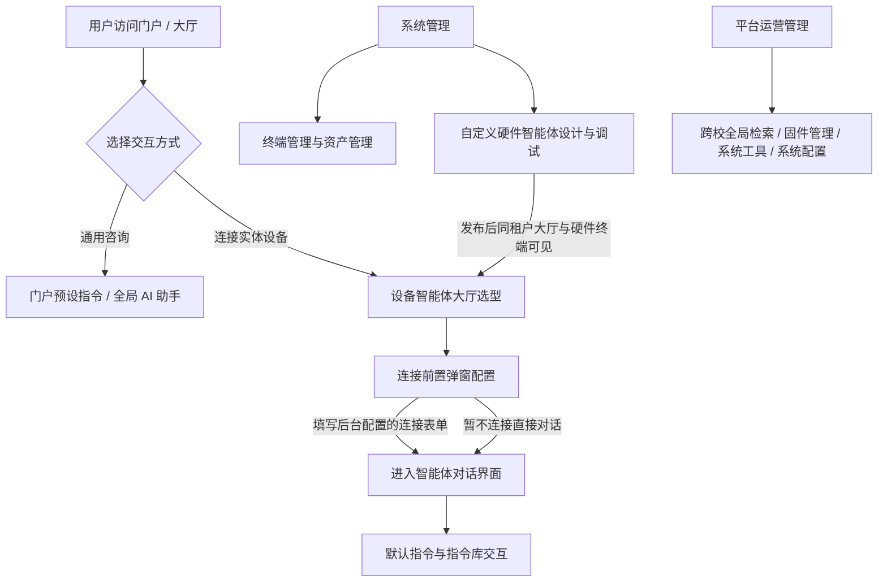

# 【V1.0.2】UUSIMA 硬件智能体系统 用户需求规格说明书

| 文档属性 | 详细信息 |
| :--- | :--- |
| **文档名称** | 【V1.0.2】UUSIMA 硬件智能体系统 用户需求规格说明书 |
| **系统名称** | 硬件智能体系统（by UUSIMA） |
| **原型地址** | `/`、`/agents`、`/agents/:id`、`/console` |
| **文档版本** | V1.0.2 |
| **编写人** | 产品与架构团队 |
| **生效日期** | 2026-11-17 |

---

## 目录

- [1. 需求背景与产品定位](#1-需求背景与产品定位)
- [2. 名词定义与缩略语](#2-名词定义与缩略语)
- [3. 业务流程与系统架构](#3-业务流程与系统架构)
- [4. 平台整体界面布局与设计规范](#4-平台整体界面布局与设计规范)
- [5. 功能需求说明](#5-功能需求说明)
  - [5.1 门户中心](#51-门户中心)
  - [5.2 设备智能体大厅](#52-设备智能体大厅)
  - [5.3 智能体对话界面](#53-智能体对话界面)
  - [5.4 系统管理](#54-系统管理)
  - [5.5 平台运营管理](#55-平台运营管理)
- [6. 非功能需求](#6-非功能需求)
- [7. 测试关注点与验收基线](#7-测试关注点与验收基线)
- [8. 其他注意事项](#8-其他注意事项)

---

## 1. 需求背景与产品定位

### 1.1 需求背景
在新工科教学实训、物联网工程与工业互联网实验场景中，硬件设备种类繁多（边缘网关、PLC、工业相机、ZigBee 传感节点、机械臂等），通信协议异构（Modbus、RS485、TCP/MQTT、RTSP），师生与工程师在设备连接、寄存器解析、算法报错排查及固件升级过程中存在操作门槛高、排障链路长、运维分散等痛点。

### 1.2 产品定位
**UUSIMA 硬件智能体系统**是一套面向新工科实训与工业物联网场景的 AI 硬件大模型与设备协同平台。系统将大模型对话能力、私有知识库与 MCP 硬件控制协议深度结合，实现自然语言故障诊断、设备实时连接、控制指令下发与资产终端集中运维的业务闭环。

### 1.3 用户角色

| 角色名称 | 核心职责 | 权限范围 |
| :--- | :--- | :--- |
| **普通用户** | 门户检索排错、浏览设备大厅、连接终端并执行对话调试 | 访问 `/`、`/agents`、`/agents/:id` 及全局 AI 助手 |
| **系统管理员** | 管理本机构资产树、终端设备及自定义智能体开发与发布 | 访问 `/console?scope=system`，操作当前租户数据 |
| **平台运营管理员** | 跨租户全局终端与智能体监管、固件分发、系统工具与配置 | 访问 `/console?scope=platform`，操作全平台全局数据 |

---

## 2. 名词定义与缩略语

| 名词 / 术语 | 英文 / 缩写 | 定义与技术说明 |
| :--- | :--- | :--- |
| **硬件智能体** | Hardware Agent | 绑定特定硬件型号、通信协议、排错知识库及 MCP 工具集的专业 AI 助手 |
| **模型上下文协议** | MCP | 标准化 AI 模型与外部硬件设备/脚本工具交互的协议接口，支持 JSON Schema 参数校验 |
| **串口 / 波特率** | Serial / Baud Rate | 硬件串行通信接口（如 `COM1`、`/dev/ttyUSB0`）及传输速率（`9600` ~ `115200` bps） |
| **Modbus 协议** | Modbus RTU / TCP | 工业现场总线通信协议，支持 `0x03` 读保持寄存器、从站地址（`1~247`）及 CRC 校验 |
| **实时流传输协议** | RTSP | 人工智能前端摄像头视频流采集协议（默认端口 `554`） |
| **资产层级树** | Asset Tree | 按“实训基地 -> 教学楼 -> 实训室/车间/大棚”组织的多级物理空间拓扑 |
| **设备序列号** | SN | 硬件终端出厂唯一物理标识（如 `NL-2026-SN88901`） |

---

## 3. 业务流程与系统架构

### 3.1 业务全景流转链路

### 3.2 核心领域实体
- **租户（TenantItem）**：隔离不同院校与实训机构的业务空间（如“新大陆教育行业云”、“新大陆工程技术学院”、“华东理工实训示范校”等）。
- **多级资产（AssetItem）**：支持无限级父子嵌套的物理空间节点，关联 `parentId`、`orderNum` 与 `schoolName`。
- **硬件终端（TerminalItem）**：归属于特定租户与资产节点，包含 `ip`、`sn`、`model`、`status`（`online` / `offline`）、`loginAccount` 及 `lastOnlineTime`。
- **设备智能体（HardwareAgentItem / CustomAgent）**：分为系统发布（`system`）与用户自定义（`custom`），核心关联连接字段（`connectionFields`）、MCP 工具集（`mcpConfig`）、多级指令库（`commandTree`）与知识库（`AgentKnowledgeBase`）。
- **终端运行日志（TerminalLogItem）**：记录终端 `开机`、`关机`、`异常`、`告警`、`调试`、`升级`、`故障` 7 类事件及底层协议报文详情。
- **固件包（FirmwareItem）**：包含版本号、适配硬件型号、文件名、文件大小、SHA-256 校验值及发布状态（`发布` / `未发布` / `下架`）。

---

## 4. 平台整体界面布局与设计规范

### 4.1 全局顶部导航栏
固定于页面顶部（高度 `64px`，`z-50`），所有主路由页面共享：
- **左侧品牌区**：展示四象限品牌徽标及“硬件智能体 系统 by UUSIMA”标识，点击跳转回首页（`/`）。
- **居中主导航**：包含 `首页`（`/`）、`设备智能体大厅`（`/agents`，兼容 `/hardware-agent` 重定向）、`控制台`（`/console`，兼容 `/ai-lab` 重定向）。
- **右侧租户与用户菜单**：
  - **租户切换器**：展示当前激活租户名称，点击弹出租户列表，切换后持久化至 `localStorage`。
  - **个人中心下拉卡片**：展示用户姓名、手机号、角色、跳转入口（“系统管理” `/console?scope=system`、“平台运营” `/console?scope=platform`）、个人设置弹窗及退出登录确认弹窗。

### 4.2 全局 AI 助手
在非 `/agents/:id` 路由页面常驻右下角，支持三种工作模式：
- **通用模式（`general`）**：支持自动检索平台默认知识库并返回引用来源（`kbCitations`）、检索结果摘要及预设指令参考步骤（`steps`）。**通用模式不支持与实体硬件直接对接或下发控制指令**，回复底部提供引导链接，指引用户前往“设备智能体大厅”开启对应设备智能体进行实机连接与控制。
- **MCP 工具生成模式（`mcp_config`）**：在智能体设计器中唤起，结合协议类型自动生成标准 MCP 工具定义，支持【应用并替换当前列表】或【追加到列表】写入当前智能体配置。
- **智能体创建模式（`agent_create`）**：通过自然语言描述生成包含名称、硬件型号、协议与 MCP 工具的智能体草稿，支持“确认创建并进入设计”或“直接创建到列表”。
- **视窗形态**：支持右下角悬浮窗与居中沉浸大窗切换，支持清空对话记录。

---

## 5. 功能需求说明

### 5.1 门户中心

#### 5.1.1 搜索与预设指令
1. **主输入框**：居中圆角大输入框，占位提示为“询问硬件排错方案、配置参数或直接唤醒设备智能体...”，支持一键清空（`X`）及回车/点击 `发送` 提交，提交后以居中沉浸模式唤起全局 AI 助手（通用模式）自动检索默认知识库。
2. **预设指令**：
   - 展示在主输入框下方，作为快捷提问胶囊按钮列表；
   - **数据来源**：由后台 `平台运营 -> 系统配置 -> 默认指令配置` 统一配置维护，系统优先读取指令树中标星为“默认指令”（`isDefault = true`）的条目（若全部未标星，则兜底取指令树前 4 条指令）；
   - **实时联动**：后台修改并保存默认指令配置后，门户中心实时同步更新预设指令标签；
   - **交互规则**：点击任意预设指令按钮，自动回填指令提问内容并唤起全局 AI 助手（通用模式）检索默认知识库返回回答。

#### 5.1.2 热门设备智能体
1. **排序与取数规则**：从当前可见的已发布设备智能体（系统发布及当前同租户下用户发布且 `status === 'published'` 的智能体）中，按照**使用量（打开次数）从高到低排序，取前 4 个**进行展示。
2. **使用量统计规则**：每当用户在门户中心或设备智能体大厅点击打开/启动某智能体时，该智能体的使用量（打开次数）自动累计 `+1` 并持久化，实时影响热门排序。
3. **展示字段**：行业彩色胶囊徽标（物联网、工业互联网、人工智能、智慧农业）、实时打开次数角标（`XX 次打开`）、设备实拍图、智能体名称、短标题/型号、简介、通信端口标识及 `立即体验` 按钮。
4. **跳转与交互**：右上角展示当前同租户下可访问的已发布设备总数及 `全部设备` 链接跳转至 `/agents`；点击卡片或 `立即体验` 触发该智能体的连接前置弹窗。

---

### 5.2 设备智能体大厅

#### 5.2.1 筛选与搜索
1. **筛选项定义表**：

| 筛选条件 | 控件类型 | 选项值 / 输入规则 | 默认值 | 校验与限制 |
| :--- | :--- | :--- | :--- | :--- |
| **发布来源** | 分段选择器 | `全部`、`系统发布`、`用户发布`（均带实时数量统计） | `全部` | 切换后重置页码至第 1 页 |
| **行业分类** | 胶囊标签组 | `全部`、`物联网`、`工业互联网`、`人工智能`、`智慧农业` | `全部` | 单选，切换后重置页码 |
| **关键词搜索** | 文本输入框 | 模糊匹配名称、描述、硬件型号、作者 | 空字符串 | 不区分大小写，实时过滤 |

2. **条件逻辑、租户可见性与重置**：三个筛选维度之间为逻辑 `AND` 关系；`系统发布` 对全平台租户可见，`用户发布` **仅展示 `status === 'published'` 且归属当前登录租户的自定义智能体（同租户下可见）**；任意筛选条件变更时自动将当前页码重置为第 1 页；空态时提供 `重置所有搜索选项` 按钮一键恢复默认条件。

#### 5.2.2 列表与视图
1. **列表展示字段**：

| 字段名称 | 展示形式 | 说明 |
| :--- | :--- | :--- |
| **行业标签** | 左上角彩色徽标 | 区分物联网、工业互联网、人工智能、智慧农业 |
| **发布来源** | 右上角徽标 | 区分 `系统发布` / `用户发布` |
| **设备图片** | 16:9 居中展示图 | 展示对应硬件设备外观图 |
| **智能体名称** | 加粗主标题 | 最多展示 1 行，超出省略 |
| **智能体描述** | 副文本 | 最多展示 1 行，超出省略 |
| **行业与作者** | 底部元信息 | 展示行业图标及用户发布作者信息 |
| **操作按钮** | 主按钮 | `开启智能体`，点击累计打开次数并触发连接前置弹窗 |

2. **分页规则**：每页固定展示 `8` 条，底部展示当前区间、总条数及上一页/页码/下一页控制条。

#### 5.2.3 连接前置弹窗
点击启动任意智能体时弹出，**表单严格展示后台为该智能体配置的“连接配置”表单内容（`connectionFields`）**：
1. **动态表单渲染规则**：
   - 读取该智能体在后台设计器【连接配置】页签中维护的字段列表，按配置顺序渲染；
   - 支持控件类型：**输入框**（`input`，细分文本 `text`、密码 `password`、数字 `number` 模式）与 **下拉框**（`select`，加载后台配置的候选选项值）；
   - 自动展示字段名称、必填红色星号（`*`）、占位提示（`placeholder`）及默认回填值（`defaultValue`）；
   - 若该智能体未配置自定义连接字段，则自动回退展示系统默认串口表单（`串口设备` 下拉、`波特率` 下拉、`设备MODBUS地址` 数字输入）。
2. **操作分支与脱敏规则**：
   - `开始对话`：校验所有标记为必填（`required`）的字段，通过后将参数拼接为连接摘要（其中 `password` 密码类字段强制脱敏显示为 `******`），携带连接参数跳转至 `/agents/:id` 并自动发起连接；
   - `暂不连接，直接进入对话`：跳过参数绑定直接跳转至 `/agents/:id`；
   - `取消` / 关闭按钮：关闭弹窗，留在本页。

---

### 5.3 智能体对话界面

#### 5.3.1 左侧设备状态与历史对话栏
1. **设备信息卡片**：展示设备实拍图、发布类型（系统发布/用户发布）、实时连接状态（`已连接` 含通道标识、`连接中...`、`未连接`）及操作按钮（`连接设备` / `断开设备`）；点击 `连接设备` 随时唤起该智能体对应的连接前置弹窗。
2. **折叠对话历史栏**：支持收起/展开，点击 `新建对话` 创建新会话；历史会话按 `今天`、`7天内`、`更早之前` 分组展示，支持切换及单条删除。

#### 5.3.2 默认指令和指令库
1. **默认指令展示**：
   - **数据来源**：取自后台自定义智能体【指令库配置】中被标记为“默认指令”（`isDefault = true`）的指令节点（未配置自定义指令树的系统智能体则取预置默认排查指令）；
   - **展示位置**：一是在左侧“默认指令与指令库”卡片顶部置顶单独高亮展示【默认指令】快捷区；二是在右侧主对话区欢迎卡片底部展示【默认指令快捷触发】按钮组；
   - **交互效果**：点击任意默认指令，自动以该指令的触发提示词向智能体发起提问，并返回对应参考响应及指令载荷代码提示。
2. **多级指令库展示**：
   - 按后台配置的多级目录结构（分类文件夹 -> 子分类 -> 指令节点）递归渲染，支持分类节点点击展开/折叠，默认指令节点右侧带星标标识；
   - 点击任意指令节点即可将触发提问与下发指令载荷带入当前对话流；未配置多级树的系统智能体自动分组展示“排错能力”与“控制能力”手风琴列表。

#### 5.3.3 主对话区与引导卡片
1. **欢迎引导卡**：展示设备大图、“下一步操作指引”列表（`guideBullets`）及知识库预期输出提示（`guideTip` + `guideHighlight`）。
2. **消息交互与输入区**：每条 AI 回复支持点赞/点踩、复制文本及代码高亮块展示，顶部支持语音播报静音切换；底部支持文本输入（Enter 发送 / Shift+Enter 换行）、语音快速输入模板、插入排错模板及图片/日志附件上传。

---

### 5.4 系统管理

控制台-系统管理面向当前租户（本校/本机构），左侧菜单严格包含 **终端管理**、**资产管理**、**自定义硬件智能体** 与 **数据总览** 四个核心模块。

#### 5.4.1 终端管理
1. **终端登录与租户归属业务规则**：
   - 用户在硬件智能体物理终端客户端上登录账号时，该终端将自动归属到当前登录所选定的租户名下，并同步显示在该租户控制台的【终端管理】列表中；
   - 若用户在同一台硬件终端上第二次登录时选择了与上次归属不同的租户，终端客户端将弹出提示询问用户**是否确认切换归属租户**；用户确认切换后，该终端的归属关系变更为新租户，并实时迁移显示至新租户的【终端管理】列表中。
2. **筛选项定义表**：

| 筛选条件 | 控件类型 | 选项值 / 输入规则 | 默认值 | 校验与限制 |
| :--- | :--- | :--- | :--- | :--- |
| **登录账号** | 文本输入框 | 模糊匹配终端当前登录账号 | 空字符串 | 不区分大小写，支持一键清空 |
| **综合关键词** | 文本输入框 | 模糊匹配终端名称、设备型号、IP 地址、序列号、关联资产 | 空字符串 | 不区分大小写，支持一键清空 |
| **关联资产** | 多选下拉面板 | 勾选多个资产名称（带各资产下终端数量徽标），支持面板内关键词二次过滤 | 未勾选（全部） | 已选资产外显为可移除标签条，支持一键清空 |
| **在线状态** | 分段选择器 | `全部`、`仅在线`、`仅离线` | `全部` | 单选切换 |

3. **条件逻辑与统计**：4 项筛选条件为逻辑 `AND` 关系；右上角展示实时统计（在线台数、离线台数）及 `刷新` 按钮；勾选终端后顶部弹出批量操作工具条，支持 `批量解除资产关联`、`批量升级固件`、`批量删除设备`（需二次确认弹窗）与 `清空选择`。

4. **列表展示字段**：

| 字段名称 | 展示形式 | 说明 |
| :--- | :--- | :--- |
| **复选框** | 多选框 | 支持单行勾选及表头本页全选 |
| **名称** | 图标 + 加粗文本 | 终端设备名称 |
| **设备型号** | 等宽字体文本 | 硬件型号编码，空值显示 `—` |
| **IP 地址** | 等宽字体文本 | 终端局域网 IP |
| **当前状态** | 彩色状态胶囊 | `在线`（绿色脉冲圆点）/ `离线`（灰色圆点） |
| **关联资产** | 资产标签 | 绑定的资产节点名称，未绑定显示 `—` |
| **最近上线时间** | 等宽时间文本 | 格式 `YYYY-MM-DD HH:mm:ss` |
| **登录账号** | 等宽胶囊文本 | 当前登录该终端的账号 |
| **设备序列号** | 等宽蓝色文本 | 唯一设备 SN 编码 |
| **操作** | 按钮 + 更多下拉 | 主按钮为 `详情`；点击 `更多` 下拉菜单展示 `关联资产`、`固件升级`、`运行日志` |

5. **详情、关联资产、固件升级、运行日志功能详细说明**：
   - **详情**：打开终端详情大屏弹窗，分为上下两部分：
     1. 上半部分展示 8 项基础信息卡片（名称与型号、所属学校、IP 地址与端口、当前状态、关联资产、最近上线时间、登录账号、设备序列号）；
     2. 下半部分左侧为**在线记录折线图**（支持按 `日`、`月`、`年` 维度及快捷范围/起止日期过滤），右侧为**AI 问答消耗柱状图**（统计各智能体 Token 消耗与调用次数），顶部支持关键词联动搜索与时间范围重置。
   - **关联资产**：打开大尺寸树形选择弹窗，顶部展示终端卡片及当前已关联资产；中部支持关键词实时检索资产节点名称/备注、一键 `全部展开` / `全部折叠`；底部实时展示选中节点的完整层级路径面包屑，支持 `解除关联`（仅当已绑定时显示）与 `确认保存关联`。
   - **固件升级**：
     1. **离线限制**：列表中离线状态的终端 `固件升级` 按钮置灰禁用，不可点击；
     2. **版本核对 Loading**：打开弹窗后首先向设备下发版本探针，展示核对中 Loading 动画；
     3. **状态判定**：核对完成后，若设备离线则拦截升级并提示原因；若已是线上最新版本则提示无需升级；若版本低于线上稳定版，展示 `立即升级固件` 按钮；
     4. **安全倒计时与进度条**：点击升级后弹出安全警示弹窗（提示保持联网不断电，**强制等待 5 秒倒计时**解锁 `确定升级` 按钮）；确认后展示实时横向进度条与阶段步骤提示，升级完成后更新终端版本号。
   - **运行日志**：
     1. **多维筛选**：支持时间范围（`全部时间`、`今天`、`近3天`、`近7天`、`近30天`）、7 种日志类型标签（`全部类型`、`开机`、`关机`、`异常`、`告警`、`调试`、`升级`、`故障`，均带条数统计）及关键词搜索（匹配说明、账号、IP、日志 ID）；
     2. **日志列表字段**：`时间`、`类型`（7 色专属徽标）、`IP 地址`、`日志说明`、`关联账号`、`操作`（`详细日志`），支持分页及每页条数切换（5/10/15 条）；
     3. **详细日志弹窗**：点击 `详细日志` 弹出纯文本原始日志窗口，格式化输出时间戳、日志 ID、类型、IP、账号、协议、寄存器状态（`REGISTERS & STATUS`）、原始报文帧（`RAW_PACKET_FRAME`）及系统处理动作（`SYSTEM_ACTION`），支持一键复制纯文本。

#### 5.4.2 资产管理
1. **全局控制与筛选项定义表**：顶部提供 `展开全部`（递归展开所有父子层级）、`折叠全部`（收起全部节点）及 `新增资产` 按钮。

| 筛选条件 | 控件类型 | 选项值 / 输入规则 | 默认值 | 校验与限制 |
| :--- | :--- | :--- | :--- | :--- |
| **资产名称** | 文本输入框 | 模糊匹配节点名称 | 空字符串 | 支持一键清空，右侧实时统计资产节点总数 |

2. **树形列表展示字段**：

| 字段名称 | 展示形式 | 说明 |
| :--- | :--- | :--- |
| **资产名称** | 缩进树形节点 + 展开箭头 | 按层级缩进展示，父节点显示展开/折叠图标，并轻量显示当前节点已绑定终端数量徽标 |
| **上级** | 文本 | 所属父级资产名称，顶级节点显示 `顶级资产` |
| **排序号** | 数字 | 同级节点排序序号 |
| **备注** | 文本 | 截断展示备注说明，悬停显示完整内容 |
| **操作** | 按钮组 | 支持 `添加子级`、`编辑`、`删除` |

3. **新增和编辑表单字段定义表**：

| 表单字段 | 控件类型 | 是否必填 | 字符长度 / 数值限制 | 默认值 | 校验与说明 |
| :--- | :--- | :--- | :--- | :--- | :--- |
| **资产名称** | 单行文本输入 | 必填 | `1 ~ 50` 个字符 | 新增为空 / 编辑回填原值 | 去除首尾空格后不可为空，实时显示字数计数 |
| **上级资产** | 下拉选择框 | 选填 | — | 顶级新增为空 / 添加子级默认回填当前父节点 ID | 编辑时自动过滤自身防止循环嵌套 |
| **排序号** | 数字输入框 | 必填 | `1 ~ 9999` 整数 | 当前资产总数 + 1 | 数字越小同级排序越靠前 |
| **备注说明** | 多行文本框 | 选填 | `0 ~ 200` 个字符 | 新增为空 / 编辑回填原值 | 实时显示字数计数 |

4. **删除资产弹窗确认逻辑**：
   - 点击 `删除` 时，系统先校验该节点是否存在子级资产：若存在子级，弹出提示弹窗阻断删除并告知“请先删除或转移所有下级资产”；
   - 若无子级资产，**弹出二次确认弹窗**（提示当前绑定此资产的终端数量，并告知删除后这些终端将重置为未关联状态），用户点击弹窗中的 `确认删除` 按钮后方可执行删除。

#### 5.4.3 自定义硬件智能体
1. **新增方式与筛选项定义表**：
   - **新增智能体下拉菜单**：提供 `手动创建` 与 `AI 创建` 两种入口。

| 筛选条件 | 控件类型 | 选项值 / 输入规则 | 默认值 | 校验与限制 |
| :--- | :--- | :--- | :--- | :--- |
| **关键词搜索** | 文本输入框 | 模糊匹配智能体名称、描述 | 空字符串 | 变更时重置页码至第 1 页 |
| **发布状态** | 分段选择器 | `全部`、`已发布`、`未发布` | `全部` | 单选切换，变更时重置页码 |

2. **手动新增表单字段定义表**：

| 表单字段 | 控件类型 | 是否必填 | 字符长度限制 | 默认值 | 校验与说明 |
| :--- | :--- | :--- | :--- | :--- | :--- |
| **智能体名称** | 单行文本输入 | 必填 | `1 ~ 50` 个字符 | 空 | 不可为空，支持右上角切换为 AI 助手创建 |
| **适配硬件型号** | 单行文本输入 | 必填 | `1 ~ 50` 个字符 | 空 | 不可为空，如 `ADVANTECH-ECU1251` |
| **功能描述** | 多行文本框 | 选填 | `0 ~ 200` 个字符 | 空 | 未填写时保存默认教学说明文案 |

3. **双模视图与列表展示字段**：支持右上角切换 `图文`（每行 4 张卡片宫格）与 `列表`（单行横向排布）两种视图模式，每条记录操作区均提供 `调试`、`设计`、`发布 / 取消发布`、`删除`（弹出二次确认弹窗后执行）四个功能按钮。

| 字段名称 | 展示形式 | 说明 |
| :--- | :--- | :--- |
| **封面图** | 缩略图 / 横幅图 | 展示硬件或智能体配图 |
| **智能体名称** | 加粗标题 | 智能体显示名称 |
| **发布状态** | 彩色状态胶囊 | `已发布`（绿色）/ `未发布`（灰色） |
| **简介描述** | 截断文本 | 最多显示 2 行描述信息 |
| **统计信息** | 图标 + 数值 | 展示使用人数（`userCount`）、关联知识库个数及文档篇数 |
| **操作按钮** | 按钮组 | `调试`、`设计`、`发布 / 取消发布`、`删除` |

4. **核心功能模块详细说明**：
   - **发布 / 取消发布**：
     1. 点击 `发布` 将智能体状态从 `draft` 切换为 `published`；
     2. **多租户与跨端可见性规则**：发布后立即显示在 Web 端**设备智能体大厅（`/agents`）**中（**仅同租户下可见**），并**同步下发至该租户下的硬件智能体终端设备**，用户在对应租户的硬件智能体终端设备上同样可以看见并调用该智能体；
     3. 点击 `取消发布` 将状态切换回 `draft`，并同步从同租户设备智能体大厅与硬件智能体终端设备上移除下线。
   - **调试**：
     1. 点击 `调试` 后，先弹出 `连接前置弹窗` 并**加载该智能体在设计器【连接配置】中保存的表单内容**，调试人员可选择填写参数连接或“暂不连接，直接进入对话”；
     2. 进入全屏对话调试弹窗后，左侧展示设备信息、实时连接状态、从设计器读取的【默认指令】与【多级设备指令库】；右侧展示欢迎指引卡（含默认指令快捷触发）、关联知识库引用标签（`kbCitations`）、代码提示及多轮会话模拟，支持不发布即验证全链路效果。
   - **设计（智能体设计器弹窗，4 大配置页签）**：
     1. **页签 1：基础配置**
        - **基本信息表单**：`智能体名称`（必填，`1 ~ 50` 字符）、`设备型号`（必填，`1 ~ 50` 字符）、`简要描述`（选填，`0 ~ 200` 字符）；
        - **知识库关联配置**：支持多选勾选已有私有知识库，并提供 `知识库管理` 入口弹窗（支持新建/编辑知识库：名称必填 `1 ~ 60` 字符、简介选填 `0 ~ 200` 字符；支持拖拽或点击上传 PDF/Word/MD/TXT 文档并自动向量化；删除知识库或文档均需弹窗确认）；
        - **设备封面图**：支持本地上传图片或输入图片地址 URL，右侧实时预览。
     2. **页签 2：连接配置**
        - **动态表单构建器**：可视化维护用户在连接该设备前需填写的表单项，支持点击 `新增表单项` 或一键快捷添加 6 种常用字段（`设备IP地址`、`登录账号`、`连接密码`、`通讯端口`、`串口号`、`校验位`）；
        - **单字段配置项**：`输入框名称`（必填）、`英文标识 (Key)`（必填，全表单唯一，字母开头可含字母/数字/`_`/`-`，自动去除空格并实时红框校验重复/非法格式）、`控件类型`（`输入框` / `下拉框`）、`输入模式`（`text` / `password` / `number`）或候选选项配置、`是否必填` 勾选、`占位提示`、`默认值`，支持 `上移`、`下移` 与 `删除`；
        - **实时表单预览**：右侧同步渲染连接前置弹窗的真实预览效果。
     3. **页签 3：MCP 配置**
        - **工具筛选与添加**：支持按关键词（名称/地址/备注）、协议类型、工具类型（`系统内置`/`用户自定义`）、状态（`已启用`/`已停用`）四维筛选，支持 `手动新增` 及唤起左下角 `AI 生成` 助手；
        - **批量操作**：支持多选勾选后进行 `批量设置`（统一修改启用状态、所属协议、工具类型或替换/追加备注）、`批量启用`、`批量停用`、`批量删除`；
        - **四维工具表单**：新增或编辑单个 MCP 工具时打开四页签弹窗——`基础信息`（名称、协议、分类、地址/指令码、备注）、`执行策略`（超时秒数、并发模式并行/串行、风险等级低/中/高）、`输入参数`（可视化行编辑与 JSON Schema 源码双模切换）与 `执行脚本`（Python 脚本编辑与在线模拟运行测试）。
     4. **页签 4：指令库配置**
        - **多级树管理**：支持 `新增一级分类`、`新增默认指令`、分类下追加子分类或子指令，统计分类数、指令总数与默认指令数；
        - **节点编辑**：选中分类可编辑分类名称（必填）；选中指令可编辑指令名称（必填）、勾选 `设为智能体默认指令`（星标）、`触发对话提示词`、`下发底层指令载荷（可选）` 及 `诊断参考响应模板`；
        - **默认指令预览**：未选中编辑节点时右侧实时汇总展示所有已标星的默认指令及所属路径。

#### 5.4.4 数据总览
数据总览以当前租户（本校）数据为作用域，支持顶部手动 `刷新`（更新时间戳并刷新采样）及 `全屏大屏 / 退出大屏` 切换，包含以下 5 大核心模块及明确计算规则：

1. **核心指标卡片（4 项 KPI）**：

| 指标名称 | 主指标计算规则 | 副指标计算规则 |
| :--- | :--- | :--- |
| **硬件智能体终端总数量** | 当前作用域内终端台账记录总数：`totalCount = count(terminals)`（单位：台） | **离线台数**：`offlineCount = totalCount - onlineCount`（单位：台） |
| **在线数量** | 当前作用域内状态为 `online` 的终端总数：`onlineCount = count(t.status === 'online')`（单位：台） | **在线率**：`onlineRate = totalCount > 0 ? ((onlineCount / totalCount) * 100).toFixed(1) : '0.0'`（单位：`%`） |
| **今日在线总时长** | 当前作用域内所有终端今日累计在线小时数之和：`todayTotalHours = ∑(t.todayHours)`，保留 1 位小数（单位：小时） | **台均今日时长**：`avgTodayHours = totalCount > 0 ? (todayTotalHours / totalCount).toFixed(1) : '0.0'`（单位：`h/台`） |
| **历史在线总时长** | 当前作用域内所有终端自接入起历史累计在线小时数之和：`historyTotalHours = ∑(t.historyHours)`，保留 1 位小数（单位：小时） | **折合天数**：`days = (historyTotalHours / 24).toFixed(0)`（取整，单位：天） |

2. **硬件智能体终端在线时长排行（前 10）**：
   - **维度切换**：支持 `历史总时长` 与 `今日时长` 两个页签切换；
   - **排序与切片规则**：按所选维度的时长字段降序排列，截取前 10 台终端；
   - **展示字段**：`排名`（1~3 名专属高亮徽标）、`终端名称`、`归属账号`（终端登录账号）、`状态`（在线/离线）、`在线时长`；
   - **进度条占比公式**：`barPct = max(8, round((当前终端时长 / 第一名终端时长) * 100))`（单位：`%`）。
3. **硬件智能体使用排行（前 10）**：
   - **筛选切换**：支持 `全部`、`自定义`、`系统预置` 三个页签过滤；
   - **排序与切片规则**：合并系统预置与当前作用域下的自定义硬件智能体，过滤后按 `调用次数 (callCount)` 降序排列，截取前 10 名；
   - **展示字段**：`排名`、`智能体名称`、`来源类型`（系统预置/自定义）、`使用人数`（人）、`调用次数`（次）；
   - **进度条占比公式**：`barPct = max(8, round((当前智能体调用次数 / 第一名调用次数) * 100))`（单位：`%`）。
4. **硬件智能体终端在线时长折线图**：
   - **时间筛选**：支持快捷预设 `7天`、`15天`、`近30天`（默认）、`90天` 及自定义起止日期（最大跨度 180 天，自动校正起始日期不晚于结束日期），支持 `查询` 与 `重置为最近30天`；
   - **图表与汇总规则**：面积折线图横轴为日期（`MM-DD`），纵轴为当日在线总时长（小时）；右上角汇总展示所选区间 **累计时长** `totalHours = ∑(每日在线总时长)` 与 **日均时长** `avgHours = totalHours / 天数`（均保留 1 位小数）；
   - **悬停 Tooltip 指标**：`当日在线总时长`（小时）、`峰值在线终端`（台）、`单台日均时长 = 当日在线总时长 / 峰值在线终端`（小时）。
5. **硬件智能体 Token 消耗柱状图**：
   - **时间筛选**：同折线图，独立控制预设范围（`7天`、`15天`、`近30天`、`90天`）与起止日期检索；
   - **图表与汇总规则**：每日堆叠柱状图分别展示 `系统预置智能体` 与 `自定义硬件智能体` 的 Token 消耗；右上角汇总展示区间 **累计 Token**（`totalTokens = ∑(每日总消耗)`，若 `>= 10,000` 则按 `(totalTokens / 10000).toFixed(2) + " 万"` 展示）与 **自定义占比** `customShare = ((∑ 自定义Token / ∑ 总Token) * 100).toFixed(1)%`；
   - **悬停 Tooltip 指标**：`Token 总消耗`、`系统预置智能体`、`自定义硬件智能体` 及 `累计推理调用次数`。

---

### 5.5 平台运营管理

平台运营管理主要是在系统管理（5.4）的基础上，增加了**跨机构/跨租户的全局搜索筛选与监控视角**，并扩展了平台级的 **固件管理**、**系统工具** 与 **系统配置** 三大底座能力。左侧菜单严格包含：**终端管理**、**自定义硬件智能体**、**固件管理**、**系统工具**、**系统配置** 与 **数据总览**。

#### 5.5.1 终端管理
- **与系统管理（5.4.1）的区别**：复用 5.4.1 的全部筛选（账号、关键词、关联资产多选、在线状态）、批量运维、详情、关联资产、固件升级与运行日志能力；区别在于数据作用域扩大为**跨校全域所有终端**，筛选栏最左侧新增 **所属学校** 下拉筛选框（默认 `全部学校`），并在数据表格 `设备型号` 列后新增 `所属学校` 列。

#### 5.5.2 自定义硬件智能体
- **与系统管理（5.4.3）的区别**：复用 5.4.3 的双模视图、新增方式及调试/设计/发布/删除全流程能力；区别在于数据作用域扩大为**跨校全域所有自定义智能体**，筛选栏最左侧新增 **发布高校** 下拉筛选框（默认 `全部学校`，切换后自动重置页码至第 1 页），便于平台运营统筹全网智能体的审核与上下架。

#### 5.5.3 固件管理
集中管理全网实训接入终端、边缘网关与工控控制器的固件包上传、版本发布、下架归档与清理。
1. **顶部统计与新增入口**：展示 `总固件数`、`已发布`、`未发布`、`已下架` 4 项统计指标，右侧提供 `上传新增固件` 主按钮。
2. **筛选项定义表**：

| 筛选条件 | 控件类型 | 选项值 / 输入规则 | 默认值 | 校验与限制 |
| :--- | :--- | :--- | :--- | :--- |
| **发布状态** | 状态页签 | `全部固件`、`已发布`、`未发布`、`已下架`（均带数量徽标） | `全部固件` | 单选切换 |
| **关键词搜索** | 文本输入框 | 模糊匹配固件名称、版本号、更新备注、文件名 | 空字符串 | 支持一键清空，实时过滤 |

3. **列表展示字段**：

| 字段名称 | 展示形式 | 说明 |
| :--- | :--- | :--- |
| **固件名称与安装包** | 图标 + 主副文本 | 展示固件名称、原始安装包文件名及文件大小 |
| **版本号** | 等宽灰色徽标 | 如 `v3.5.1-PATCH` |
| **适配硬件型号** | 蓝色标签 | 适用的硬件设备型号或 `通用终端 (全系兼容)` |
| **更新备注说明** | 两行截断文本 | 悬停显示完整更新说明 |
| **上传时间** | 时钟图标 + 时间 | 固件上传时间戳 |
| **发布状态** | 彩色状态胶囊 | `发布`（绿）、`未发布`（琥珀）、`下架`（灰） |
| **操作** | 按钮组 | 支持 `详情`（查看完整信息与复制 SHA-256 指纹）、`发布` / `下架` / `重新发布` 状态流转及 `删除`（需二次确认弹窗） |

4. **上传新增固件弹窗表单定义表**：

| 表单字段 | 控件类型 | 是否必填 | 字符长度 / 格式限制 | 默认值 | 校验与说明 |
| :--- | :--- | :--- | :--- | :--- | :--- |
| **固件安装包文件** | 拖拽/文件选择 | 必填 | `.bin` / `.tar.gz` / `.zip` / `.img` / `.hex`，单文件 `<= 200MB` | 空 | 选择文件后自动解析文件大小并智能预填固件名称 |
| **固件名称** | 单行文本输入 | 必填 | `1 ~ 60` 个字符 | 空 | 实时显示字数计数 |
| **固件版本** | 单行文本输入 | 必填 | `1 ~ 30` 个字符 | 空 | 等宽字体，如 `v3.5.2-RELEASE` |
| **适配硬件型号** | 下拉选择框 | 必填 | — | `通用终端 (全系兼容)` | 可选特定设备型号或全系兼容 |
| **发布状态** | 单选卡片组 | 必填 | `未发布` / `发布` | `未发布` | 选中 `发布` 后全网低版本终端可即刻检测升级 |
| **备注 / 更新说明** | 多行文本框 | 必填 | `1 ~ 500` 个字符 | 空 | 实时显示字数计数，提交时模拟计算 SHA-256 校验码并展示上传进度条 |

#### 5.5.4 系统工具
统一维护全平台可复用的系统内置及扩展 MCP 工具库。
1. **顶部统计与新增入口**：展示 `总工具数`、`已启用`、`已停用`、`系统内置` 4 项实时计数；提供 `手动新增` 与 `AI 生成` 两个创建入口。
2. **筛选项定义表**：

| 筛选条件 | 控件类型 | 选项值 / 输入规则 | 默认值 | 校验与限制 |
| :--- | :--- | :--- | :--- | :--- |
| **关键词搜索** | 文本输入框 | 模糊匹配工具名称、地址/指令码、备注说明 | 空字符串 | 支持一键清空，变更重置页码 |
| **协议类型** | 下拉选择框 | `全部协议` 及所有已支持协议（`modbus`、`mqtt`、`tcp`、`http` 等） | `全部协议` | 变更重置页码 |
| **工具类型** | 下拉选择框 | `全部类型`、`系统内置`、`用户自定义` | `全部类型` | 变更重置页码 |
| **状态** | 下拉选择框 | `全部状态`、`已启用`、`已停用` | `全部状态` | 变更重置页码，4 项条件呈 `AND` 关系 |

3. **批量操作与列表展示字段**：支持勾选复选框执行 `批量设置`（统一修改启用状态、所属协议、工具类型或替换/追加备注）、`批量启用`、`批量停用`、`批量删除`；列表支持分页及每页条数切换（5/10/20 条）。

| 字段名称 | 展示形式 | 说明 |
| :--- | :--- | :--- |
| **复选框** | 多选框 | 支持单行勾选及本页全选 |
| **工具名称** | 等宽加粗主文本 + 副参数 | 唯一方法名（如 `read_holding_registers`）及版本号/脚本语言/风险等级/地址摘要 |
| **协议类型** | 等宽紫蓝文本 | 标识所属协议及子分类 |
| **工具类型** | 彩色文本 | 区分 `系统内置` 与 `用户自定义` |
| **状态** | 圆点状态文本 | `已启用`（绿点）/ `已停用`（灰点） |
| **添加时间** | 等宽时间文本 | 工具入库时间 |
| **备注说明** | 单行截断文本 | 工具功能描述，悬停查看完整文本 |
| **操作** | 按钮组 | `编辑`（打开四维配置弹窗：`基础信息`、`执行策略`、`输入参数`、`执行脚本`）、`启用 / 停用`、`删除`（弹窗确认） |

#### 5.5.5 系统配置
配置全平台全局生效的**默认 AI 助手**底座参数（含知识库文档与预设指令树），修改后实时同步驱动首页预设指令及全局 AI 助手（通用模式）的检索与回答。
1. **顶部控制与助手身份配置**：
   - 顶部展示 `知识文件`、`已向量化`、`默认指令` 及 `处理中` 实时计数，提供 `测试默认 AI 助手`（一键唤起全局助手验证最新配置）与 `恢复默认`（弹窗确认后重置为平台初始配置）按钮；
   - 支持点击 `编辑助手信息` 维护 `助手显示名称`（必填，`1 ~ 40` 字符）与 `默认欢迎语`（选填，`0 ~ 200` 字符）。
2. **默认知识库配置（子页签 1）**：
   - **知识库基础信息**：支持编辑 `默认知识库名称`（必填，`1 ~ 60` 字符）与 `知识库用途说明`（选填，`0 ~ 200` 字符）；
   - **筛选项定义表**：

| 筛选条件 | 控件类型 | 选项值 / 输入规则 | 默认值 | 校验与限制 |
| :--- | :--- | :--- | :--- | :--- |
| **关键词搜索** | 文本输入框 | 模糊匹配知识库文件名或正文内容关键词 | 空字符串 | 支持一键清空 |
| **文件格式** | 下拉选择框 | `全部格式`、`MD`、`PDF`、`DOC`、`TXT` | `全部格式` | 单选过滤 |

   - **文件新增与上传**：提供 `新建知识文件`（弹窗表单包含 `文件名称` 必填 `1 ~ 100` 字符、`文件格式` 下拉、`文件内容` 必填不限长度且实时统计字符与大小）、`上传本地文件` 及拖拽上传区（支持 PDF/Word/MD/TXT/CSV/JSON），上传后自动执行向量化索引；
   - **列表展示字段**：`文件名称`（带格式彩色角标）、`文件内容摘要`（两行截断）、`大小`、`更新时间`、`状态`（`已向量化` / `向量化中`）、`操作`（`配置内容`、`AI 试读`、`删除` 弹窗确认）。
3. **默认指令配置（子页签 2）**：
   - **多级指令树编辑**：支持 `新增一级分类`、`新增默认指令`、分类下新增下级及编辑/删除节点；
   - **节点表单字段**：分类节点包含 `分类名称`（必填，`1 ~ 40` 字符）；指令节点包含 `指令名称`（必填，`1 ~ 40` 字符）、`设为默认 AI 助手快捷指令`（标星复选框，`isDefault`）、`触发对话提示词`（必填）、`推荐下发指令/动作标识`（可选）及 `标准诊断参考响应模板`；
   - **默认指令预览**：右侧实时汇总标星的默认指令（同步呈现在首页“预设指令”及全局助手快捷芯片中），支持一键点击 `试运行` 验证检索结果。

#### 5.5.6 数据总览
- **与系统管理（5.4.4）的区别**：完全复用 5.4.4 的 4 项 KPI 指标、2 个 Top10 排行榜、2 个趋势图表及全部计算规则；区别在于默认聚合全网所有学校/租户数据，且在顶部标题栏右侧新增 **切换学校** 下拉框（默认 `全部学校`），支持运营人员一键切换查看全网全局态势或下钻任意单所学校的数据总览。

---

## 6. 非功能需求

---

## 7. 测试关注点与验收基线

---

## 8. 其他注意事项
